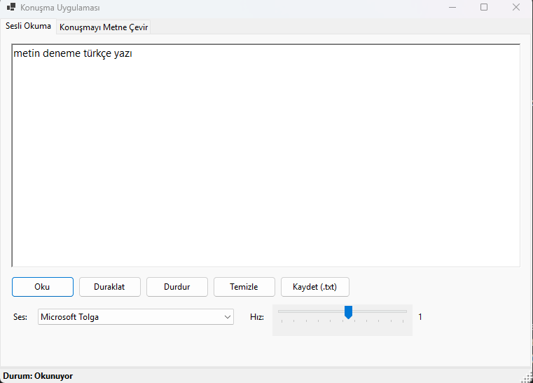
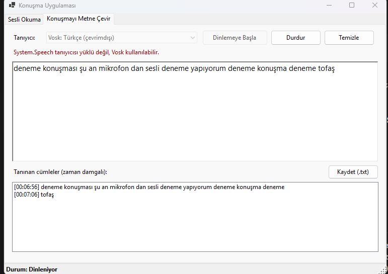

# YMH219-SpeechApp (Sesli Okuma ve Konuşmayı Metne Çevirme)

İki bölümlü bir C# Windows Forms uygulaması. **Sesli Okuma** sekmesi metin kutusundaki yazıyı seçilen sesle ve hızda okur; okuma duraklatılabilir, devam ettirilebilir ve durdurulabilir. **Konuşmayı Metne Çevir** sekmesi mikrofondan alınan konuşmayı metne aktarır ve tanınan cümleleri zaman damgasıyla listeler. Aktif işlem durum çubuğunda görünür: Okunuyor / Duraklatıldı / Dinleniyor / Boşta. YMH 219 Nesne Tabanlı Programlama dersi ek uygulama ödevidir.

## Kullanılan teknolojiler

- C# / .NET 10, Windows Forms (`net10.0-windows`)
- NuGet paketleri:

| Paket | Sürüm | Kullanım |
|---|---|---|
| `System.Speech` | 11.0.0 | `SpeechSynthesizer` (TTS), `SpeechRecognitionEngine` + `DictationGrammar` (STT) |
| `Vosk` | 0.3.38 | Çevrimdışı Türkçe konuşma tanıma |
| `NAudio` | 3.3.0 | Mikrofondan 16 kHz mono ses alma (`WaveIn`) |

- Vosk Türkçe modeli: `vosk-model-small-tr-0.3` (~35 MB, repoda yok, aşağıdaki adımla indirilir)

## Kurulum ve çalıştırma

Gereksinim: .NET 10 SDK; tasarımcı için Visual Studio 2026 veya dotnet run. Konuşma tanıma için bir mikrofon.

```
git clone https://github.com/mah0cb/YMH219-SpeechApp.git
cd YMH219-SpeechApp
```

### Vosk Türkçe modelini indirme (konuşma tanıma için gerekli)

1. Modeli indirin: <https://alphacephei.com/vosk/models/vosk-model-small-tr-0.3.zip>
   (tüm modeller: <https://alphacephei.com/vosk/models>)
2. Zip'i açın ve klasörü şu yola koyun:

```
YMH219-SpeechApp/SpeechApp/VoskModels/vosk-model-small-tr-0.3/
    final.mdl, Gr.fst, HCLr.fst, mfcc.conf, ivector/ ...
```

PowerShell ile (repo kök klasöründe):

```
Invoke-WebRequest https://alphacephei.com/vosk/models/vosk-model-small-tr-0.3.zip -OutFile model.zip
Expand-Archive model.zip SpeechApp\VoskModels
Remove-Item model.zip
```

Derleme sırasında model çıktı klasörüne (`bin\...\VoskModels\`) kopyalanır. `SpeechApp/VoskModels/` klasörü `.gitignore`'dadır. Model yoksa sesli okuma yine çalışır; konuşma sekmesinde uyarı gösterilir.

### dotnet run ile (VS Code)

```
dotnet run --project SpeechApp/SpeechApp.csproj
```

### Visual Studio ile

1. `YMH219-SpeechApp.sln` dosyasını açın.
2. F5 ile çalıştırın. Form tasarımcısı için `SpeechApp/Forms/AnaForm.cs` dosyasına çift tıklayın.

### Windows konuşma dil paketi (isteğe bağlı)

- **Okuma sesleri:** Ayarlar > Saat ve dil > Dil ve bölge > Türkçe > Dil seçenekleri > **Konuşma** paketini indirin. Uygulama yüklü sesleri **Ses** kutusunda listeler (bu bilgisayarda Microsoft Zira ve Microsoft Tolga).
- **System.Speech tanıyıcısı:** Masaüstü tanıyıcıları yalnızca bazı dillerde vardır (en-US, en-GB, de-DE, fr-FR, es-ES, ja-JP, zh-CN/TW), **Türkçe yoktur**. Eski Windows sürümlerinde Ayarlar > Saat ve dil > Konuşma bölümünden ilgili dilin konuşma paketi kurulup Denetim Masası > Konuşma Tanıma açıldığında tanıyıcı yüklenir. Windows 11 24H2 ve sonrasında eski Windows Konuşma Tanıma kaldırıldığı için tanıyıcı çoğunlukla bulunamaz; bu durumda uygulama **Vosk** ile çalışır. Yüklü tanıyıcı varsa **Tanıyıcı** kutusunda otomatik listelenir.

### Test adımları

1. Sesli Okuma: metin yazın, **Oku**. Durum "Okunuyor" olur. **Duraklat** → "Duraklatıldı" (düğme "Devam Et" olur), **Durdur** → "Boşta".
2. **Ses** kutusundan Tolga'yı seçin, **Hız** çubuğunu değiştirip tekrar okutun.
3. Konuşmayı Metne Çevir: "Vosk: Türkçe" seçiliyken **Dinlemeye Başla**, konuşun. Metin kutusu ve zaman damgalı liste dolar; durum "Dinleniyor".
4. Mikrofonu çıkarıp uygulamayı açın: uyarı satırında "Mikrofon algılanmadı" yazar, dinleme başlatılınca Türkçe hata mesajı çıkar.
5. Her iki sekmedeki **Kaydet (.txt)** ile metni dosyaya kaydedin.

## Temel özellikler

- **Sesli okuma (TTS):** Oku, Duraklat/Devam Et, Durdur, Temizle
- Yüklü seslerin listelenmesi ve seçilmesi (`GetInstalledVoices`), TrackBar ile okuma hızı (-10…10)
- **Konuşmayı metne çevirme (STT):** mikrofondan sürekli dinleme, tanınan metin RichTextBox'a eklenir
- Tanınan cümleler `[SS:dd:ss]` zaman damgasıyla ListBox'ta listelenir
- İki STT uygulaması aynı arayüzle: System.Speech (yüklü tanıyıcı varsa) ve Vosk (Türkçe, çevrimdışı)
- Okunacak metni veya tanınan cümleleri `.txt` dosyasına kaydetme
- Durum çubuğunda aktif işlem: Okunuyor / Duraklatıldı / Dinleniyor / Boşta
- Form kapanırken tüm konuşma servisleri `Dispose` edilir (`IDisposable`)

### Hata yönetimi

| Durum | Davranış |
|---|---|
| Mikrofon yok | Konuşma sekmesinde kırmızı uyarı satırı; dinleme başlatılırsa "Mikrofon bulunamadı" mesajı |
| Mikrofon başka uygulamada / izin kapalı | "Mikrofon açılamadı" mesajı, ayrıntısıyla |
| System.Speech tanıyıcısı yok | Uyarı satırında bildirilir, listede yalnızca Vosk görünür |
| Vosk modeli yok veya bozuk | Modelin indirileceği klasör yoluyla birlikte hata mesajı |
| Ses aygıtı / okuma sesi yok | Sesli okuma başlatılamadığında hata mesajı, Oku düğmesi pasif |
| Boş metin okutma / kaydetme | Bilgi mesajı |
| Dosya yazılamıyor | Hata mesajı |

Hiçbir durumda uygulama kapanmaz. Hata mesajları servislerde `SpeechServiceException` ile Türkçe olarak üretilir, form yalnızca gösterir. Vosk sesi arka plan thread'inde işlendiği için arayüz güncellemeleri `BeginInvoke` ile UI thread'ine aktarılır.

### Proje yapısı

| Dosya | Görev |
|---|---|
| `Services/ITextToSpeechService.cs` | TTS sözleşmesi: Speak, Pause, Resume, Stop, Rate, ses seçimi, `StatusChanged` / `ErrorOccurred` event'leri |
| `Services/SystemSpeechTtsService.cs` | `SpeechSynthesizer`, `SpeakAsync`, `SpeakAsyncCancelAll`, `StateChanged` / `SpeakCompleted` |
| `Services/ISpeechToTextService.cs` | STT sözleşmesi: Start, Stop, `SpeechRecognized` / `ErrorOccurred` event'leri |
| `Services/SystemSpeechSttService.cs` | `SpeechRecognitionEngine` + `DictationGrammar`, `SetInputToDefaultAudioDevice`, `RecognizeAsync(Multiple)` |
| `Services/VoskSttService.cs` | NAudio `WaveIn` (16 kHz mono) → Vosk tanıyıcı, JSON sonucundan metin |
| `Services/SpeechToTextProviders.cs` | Kullanılabilir tanıyıcıları listeler, eksik tanıyıcı/model/mikrofon uyarısı üretir |
| `Services/SpeechServiceException.cs` | Kullanıcıya gösterilecek Türkçe hata |
| `Models/SpeechStatus.cs` | Boşta / Okunuyor / Duraklatıldı / Dinleniyor ve Türkçe karşılıkları |
| `Models/RecognizedSentence.cs` | Tanınan cümle + zaman (listede görünen biçim) |
| `Forms/AnaForm.cs` | Arayüz ve olay bağlama |

## Ekran görüntüleri

**Sesli Okuma: Tolga sesiyle okuma sürerken**



**Konuşmayı Metne Çevir: Vosk ile dinleme, zaman damgalı cümleler**



## Bilinen sınırlamalar / geliştirme notları

- Bilgisayarda Türkçe SAPI sesi yoksa metin İngilizce sesle okunur.
- System.Speech masaüstü tanıyıcısının Türkçe sürümü yoktur; Türkçe tanıma için Vosk kullanılır.
- Vosk'un küçük Türkçe modeli hızlıdır ama doğruluğu sınırlıdır; noktalama ve büyük harf üretmez, özel adlarda ve gürültülü ortamda hata yapabilir. Daha büyük bir model aynı klasör yapısıyla kullanılabilir (`VoskSttService.DefaultModelPath`).
- Hız ve ses değişikliği bir sonraki **Oku**'da geçerli olur, süren okumayı değiştirmez.
- Vosk mikrofon olarak Windows'un varsayılan kayıt aygıtını kullanır; aygıt seçimi arayüzde yoktur.
- Okuma ve dinleme aynı anda yapılırsa hoparlörden çıkan ses de tanınabilir.
- Vosk yerel kütüphanesi (`libvosk.dll`) 64 bit olduğu için uygulama x64 Windows'ta çalıştırılmalıdır.

## Öğrenci

Mahmut Başcı, 205542016
